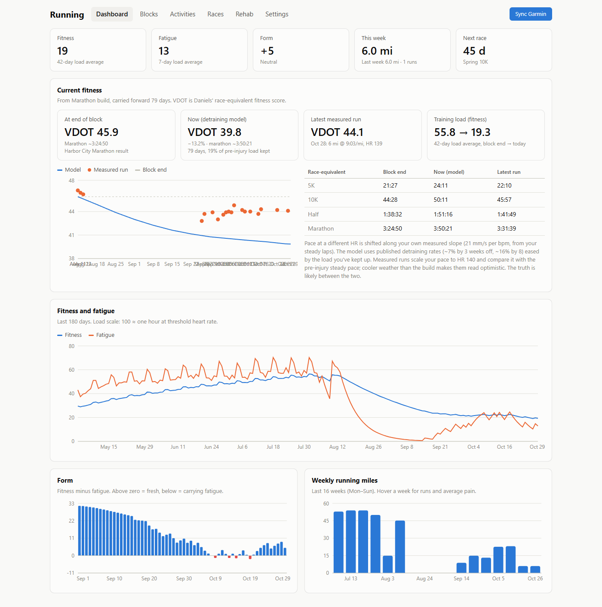
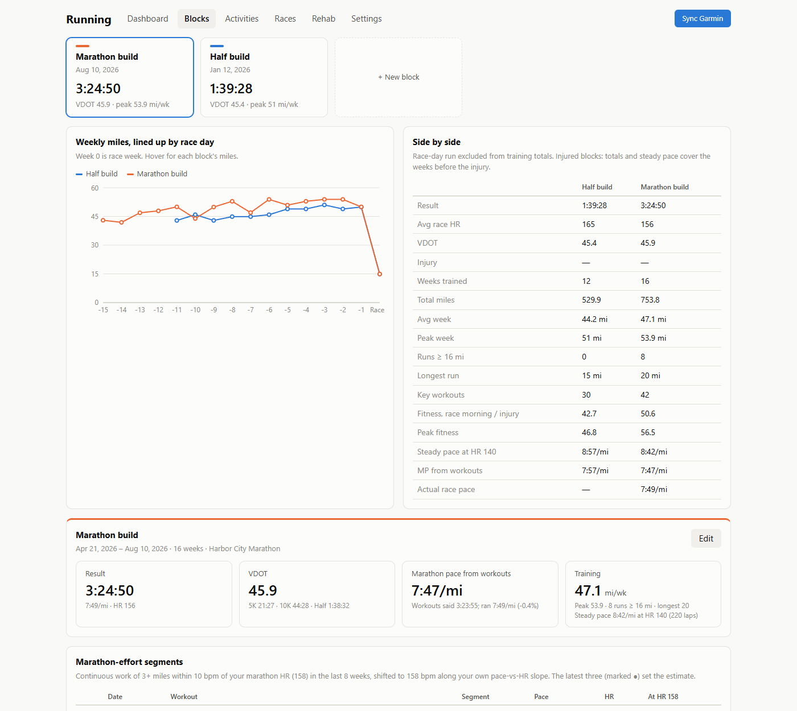
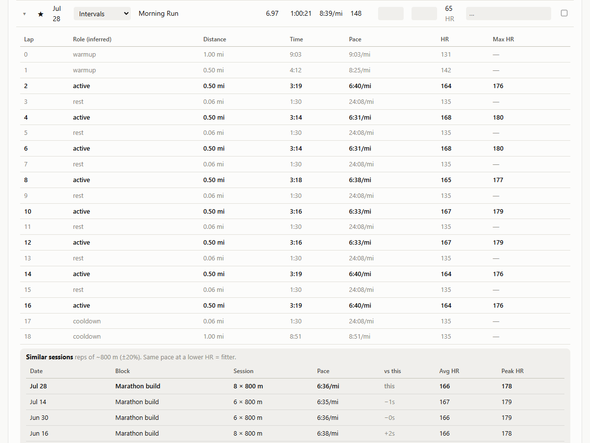

# Running App

A self-hosted running tracker. It pulls your activities from Garmin Connect, adds manual inputs
(RPE, pain, notes, a daily rehab log), and turns them into training load, fitness / fatigue / form,
training-block comparisons, a marathon-pace estimate and a current-fitness estimate.

Everything runs locally: your activities live in a SQLite file on your machine and nothing is sent
anywhere except Garmin's own API.



| Training blocks, compared side by side | Laps of an unnamed run, with reps inferred |
|---|---|
|  |  |

<sub>Screenshots use the fictional demo data from `scripts/seed_demo.py`.</sub>

## Layout

```
backend/   FastAPI + SQLite. Engine formulas live in app/engine/.
  app/engine/load.py      per-run load + fitness/fatigue/form model
  app/engine/workouts.py  workout classification, lap "work" detection, HR-scaled pace
  app/engine/vdot.py      Daniels VDOT, race equivalents, training paces
  app/engine/fitness.py   pace-vs-HR slope, steady-pace marker, detraining model
  app/routers/blocks.py   training blocks + marathon-pace estimate
  app/sync.py             Garmin → database
  garmin_login.py         one-time Garmin login (saves tokens, not your password)
  data/running.db         your data (created on first run, git-ignored)
frontend/  React + Vite + Recharts
```

## Setup

Requires Python 3.11+ and Node 20.19+ (or 22.12+).

```
cd backend
python -m venv .venv
.venv\Scripts\pip install -r requirements.txt      # macOS/Linux: .venv/bin/pip install -r requirements.txt

cd ../frontend
npm install
```

The commands below use Windows paths (`.venv\Scripts\python`); on macOS/Linux use `.venv/bin/python`.

### 1. Log in to Garmin (once)

```
cd backend
.venv\Scripts\python garmin_login.py
```

Enter your Garmin Connect email and password; if your account has 2FA you'll be asked for the
code. Only session tokens are saved, to `backend/.garmin_tokens/` (git-ignored). Re-run this if
sync ever says the session is invalid.

### 2. Run it

Two terminals:

```
cd backend;  .venv\Scripts\python -m uvicorn app.main:app --reload --port 8000
cd frontend; npm run dev
```

Open http://localhost:5173 and press **Sync Garmin**. The first sync pulls ~400 days of activities.
To backfill further: `POST /api/sync` with `{"since": "YYYY-MM-DD"}`.

### 3. Enter your own numbers

The app ships with generic defaults. Before trusting any number it shows:

- **Settings** — set your max HR, resting HR, lactate-threshold HR (LTHR), marathon HR (the average
  HR you can hold for a marathon) and sex (used for TRIMP weighting). Load, workout classification
  and pace estimates all depend on these.
- **Races** — add your past results and upcoming races (name, date, distance, priority A/B/C, goal
  and result times). Results calibrate the marathon-pace estimate; the next dated race shows on the
  Dashboard.
- **Blocks** — create a training block for each build (a date range, optionally linked to a race).
  If a build was cut short, set its *interrupted on* date so estimates use only the weeks before.
- **Activities / Rehab** — optionally log RPE, pain and notes per run, and a daily rehab log.

### 4. Spoken run recaps (optional, ElevenLabs)

Each run on **Activities** gets a 🔊 button that reads a short recap aloud, e.g. *"Yesterday's
tempo run: 8.1 miles in 58 minutes 20 seconds, averaging 7:12 per mile at an average heart rate of
158. The hard part was 4.0 miles at 6:41 per mile. That's 9 seconds per mile faster than your
average for similar runs over the last 8 weeks. Training load 92, with 31.4 miles so far this week."*

The backend writes the text from your own data (`app/recap.py`; "similar runs" = same workout type,
distance within ±25%, last 8 weeks) and sends only that text to
[ElevenLabs text-to-speech](https://elevenlabs.io/docs). To turn it on, copy `backend/.env.example`
to `backend/.env` (git-ignored), set `ELEVENLABS_API_KEY`, and restart the backend. Optionally set
`ELEVENLABS_VOICE_ID` to any voice from your library. Without a key the button is hidden; the text
alone is at `GET /api/activities/{id}/recap`.

## Demo data

To try the UI without a Garmin account, seed a separate throwaway database with a fictional runner's
year: two finished builds with structured workouts, a break, a return with rehab logs, and upcoming
races. It refuses to touch `running.db` and is safe to re-run.

```
cd backend
$env:RUNNING_DB="data\demo.db"; $env:PYTHONPATH="."; .venv\Scripts\python scripts\seed_demo.py
$env:RUNNING_DB="data\demo.db"; .venv\Scripts\python -m uvicorn app.main:app --port 8000
```

On macOS/Linux: `RUNNING_DB=data/demo.db PYTHONPATH=. .venv/bin/python scripts/seed_demo.py`, then
`RUNNING_DB=data/demo.db .venv/bin/python -m uvicorn app.main:app --port 8000`.

## Tests

```
cd backend; .venv\Scripts\python -m pytest -q
```

## How load is calculated

100 points ≈ one hour at threshold heart rate. Per activity:
1. your manual override, if set
2. heart-rate TRIMP, blended toward RPE load by the **RPE weight** setting when you've entered RPE
3. RPE × minutes alone, if there's no heart rate

Fitness = 42-day exponential average of daily load, fatigue = 7-day, form = fitness − fatigue.

## Blocks

A block is a date range (default: 18 weeks before a race). For each block the app shows weekly
miles lined up by weeks-to-race, totals, fitness on race morning, the race result as a VDOT, and
the key workouts.

- **Key workouts** are classified from structured-workout names (`W8 Sat Long Run - 19mi Race Practice`);
  unnamed runs are classified from their **laps** (`infer_structure` in `engine/workouts.py`):
  - lap-button presses: laps split into fast reps and slow recoveries at the biggest pace gap
    → intervals (reps with rests) or tempo (one continuous fast block)
  - auto mile laps: 2+ consecutive miles ≥ 7% faster than the run's easy miles (3+ in a 13+ mile run)
    → tempo, or race practice inside a long run
  - guards: reps must be ≤ 80% of the run, HR ≥ 86% of threshold (or peak ≥ 90% for short reps),
    and ≥ 1 mile of total rep distance; otherwise distance + average HR decide.
  Change any run's type or star on Activities (▸ shows its laps and inferred roles).
- **Laps** are cached locally. Each sync fetches laps for up to 40 runs that lack them;
  `scripts/backfill_laps.py` fetches the rest. The *work* part of a run is the active reps,
  the fastest plan steps (race practice), the inferred segment, or the whole run if steady.
- **Your pace-vs-HR slope** (m/s per bpm) is fitted from steady mile laps across all history
  (`fit_hr_slope`) and used for every "pace at another HR" conversion.
- **Marathon pace from workouts**: continuous 3+ mile work segments within 10 bpm of your marathon
  HR (Settings) in the last 8 weeks, shifted to that HR along your slope; median of the latest three.
  A block with a marathon result also gets a calibration (actual ÷ predicted) that later blocks borrow.
- **Similar sessions**: expanding a workout lists sessions with the same shape from every block
  (reps within ±20% of the rep length, or continuous efforts within ±35%) with pace, HR and peak HR.
- Newer Garmin files tag plain auto laps `INTERVAL`; only step indexes or warm-up / rest / cool-down
  tags mark a run as a watch workout, so pickups inside those long runs are still detected.
- **Easy-run pace at a fixed HR** (the aerobic HR setting): monthly aerobic-efficiency trend across all your history.
- **Injury / DNF**: a block can have an *interrupted on* date and its race a `dnf` status. Totals,
  the steady-pace marker and the marathon-pace estimate then use only the weeks before the injury.
- **Steady pace at 85% of LTHR**: median of steady mile laps (first lap skipped) in the
  last 8 weeks, each shifted to that HR. Comparing it with a finished marathon block turns that race
  into an estimate.

## Current fitness (Dashboard)

`engine/fitness.py`, `routers/fitness.py`. Starts from the most recent block with an estimate:
its race result if it has one, otherwise the average of the calibrated marathon-effort workouts and
the steady-pace ratio vs the latest finished marathon (each shown separately). From the injury (or
race) date it applies a detraining model: VO2max-style loss of ~7% at 3 weeks / ~16% at 8 weeks
without training, eased by the share of pre-injury load kept up (cross-training counts). Steady runs
since then are shown as measured checks; cooler weather than the build makes those read optimistic.

## Roadmap

- [x] Garmin sync, activity list with RPE / pain / notes, daily rehab log, load charts, races
- [x] Training blocks, key workouts with laps, block comparison, marathon-pace estimate, aerobic trend
- [x] Current-fitness estimate with a detraining model
- [ ] Training block planner toward a goal race (base → build → peak → taper)
- [ ] Workout builder with paces from current fitness; push structured workouts to the watch
- [ ] Strength sessions matched to the training phase
- [ ] Garmin HRV / sleep / resting HR in the daily view
